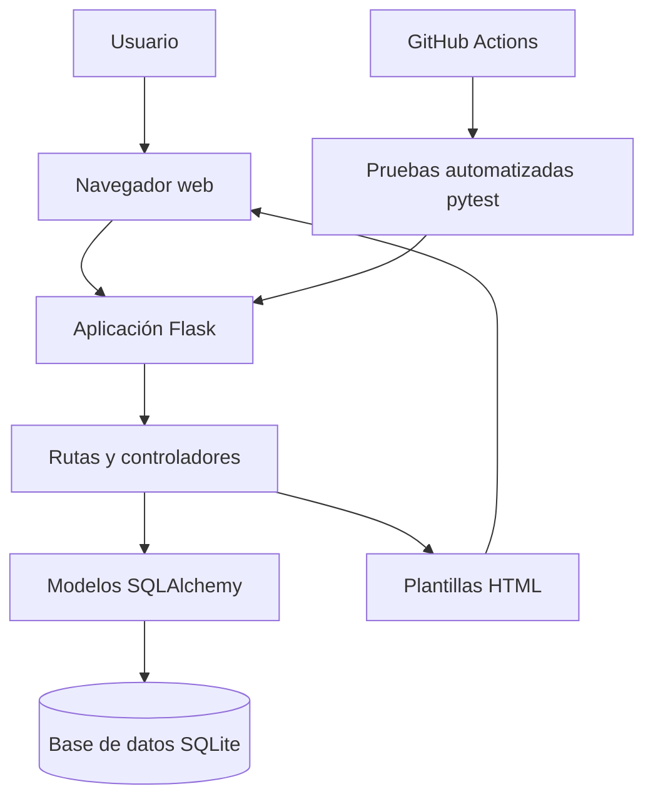

# Arquitectura técnica de ManteniSoft

## 1. Descripción general

ManteniSoft es una aplicación web desarrollada con Python y Flask para gestionar equipos y sus respectivos mantenimientos. Su arquitectura sigue un modelo cliente-servidor y utiliza SQLAlchemy para administrar la persistencia de información en una base de datos SQLite.

El sistema permite registrar equipos, programar mantenimientos, cambiar su estado a completado y consultar el seguimiento de las actividades mediante filtros.

## 2. Diagrama de arquitectura

## 3. Componentes principales

### 3.1. Capa de presentación

Está formada por las plantillas HTML ubicadas en `app/templates/`. Permite al usuario interactuar con el sistema mediante las páginas de inicio, equipos, mantenimientos y seguimiento.

### 3.2. Capa de aplicación

Está implementada con Flask y contiene las rutas y la lógica que procesa las solicitudes del usuario.

Sus principales funcionalidades son:

- Panel principal: presenta indicadores de equipos y mantenimientos.
- Gestión de equipos: permite registrar y consultar equipos.
- Gestión de mantenimientos: permite programar y completar actividades.
- Seguimiento: permite consultar los mantenimientos mediante filtros.

### 3.3. Capa de datos

Utiliza SQLAlchemy como herramienta de mapeo objeto-relacional (ORM). Los modelos principales son:

- `Equipo`: almacena el código, nombre, área y fecha del último mantenimiento del equipo.
- `Mantenimiento`: almacena el equipo asociado, fecha programada, descripción y estado de la actividad.

La información se almacena en SQLite.

### 3.4. Capa de calidad

El proyecto utiliza pytest para ejecutar pruebas automatizadas. Estas verifican las funcionalidades, validaciones, respuestas y comportamientos de la aplicación.

GitHub Actions ejecuta las pruebas automáticamente durante los eventos configurados en el repositorio.

## 4. Módulo de seguimiento

El módulo Seguimiento permite consultar los mantenimientos registrados y clasificarlos según su estado y fecha programada.

Los filtros disponibles son:

- **Todos:** muestra todos los mantenimientos.
- **Pendiente:** muestra actividades pendientes cuya fecha programada es igual o posterior al día actual.
- **Vencido:** muestra actividades pendientes cuya fecha programada es anterior al día actual.
- **Completado:** muestra las actividades cuyo estado es Completado.

Los registros se ordenan por fecha programada para facilitar su consulta.

## 5. Flujo de funcionamiento

1. El usuario accede a ManteniSoft desde un navegador web.
2. Flask recibe la solicitud y determina la ruta correspondiente.
3. La lógica de aplicación procesa los datos recibidos.
4. SQLAlchemy consulta o modifica los registros en SQLite.
5. Flask prepara la respuesta utilizando las plantillas HTML.
6. El navegador presenta la información al usuario.

## 6. Estructura relacionada con la arquitectura

- `app/__init__.py`: inicialización y configuración de la aplicación.
- `app/routes.py`: rutas y lógica de las funcionalidades.
- `app/models.py`: definición de los modelos y acceso a datos.
- `app/templates/`: plantillas de presentación.
- `app/static/`: recursos estáticos de la interfaz.
- `tests/test_app.py`: pruebas automatizadas.
- `.github/workflows/tests.yml`: configuración de integración continua.
- `config.py`: configuración de los entornos.
- `run.py`: punto de entrada para ejecutar la aplicación.

## 7. Consideraciones técnicas

La aplicación utiliza SQLite para simplificar el almacenamiento de datos en el entorno actual. Las pruebas automatizadas emplean una base de datos SQLite en memoria, lo que permite ejecutar los casos de prueba de forma aislada sin modificar la base de datos de desarrollo.

La integración continua permite verificar automáticamente el proyecto y controlar la cobertura de sentencias mediante pytest-cov.