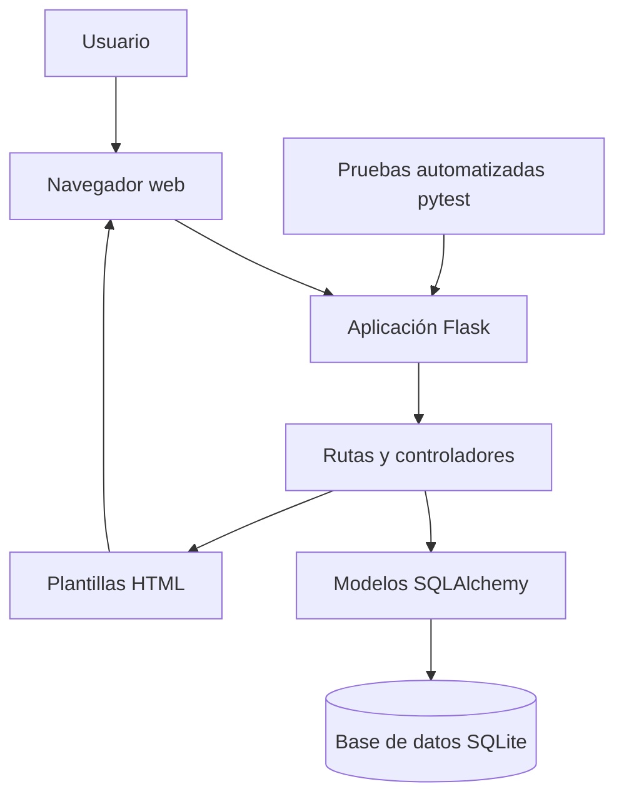

# Arquitectura técnica de ManteniSoft

## 1. Descripción general

ManteniSoft utiliza una arquitectura web basada en Flask. El usuario interactúa con el sistema mediante un navegador web. Las solicitudes son procesadas por las rutas de Flask, que utilizan SQLAlchemy para gestionar la información almacenada en SQLite.

## 2. Diagrama de arquitectura

## 3. Componentes principales

- **Navegador web:** permite acceder a las funcionalidades del sistema.
- **Flask:** administra las solicitudes y respuestas de la aplicación.
- **Rutas y controladores:** gestionan el registro de equipos y la programación de mantenimientos.
- **SQLAlchemy:** facilita la comunicación entre la aplicación y la base de datos.
- **SQLite:** almacena los equipos y sus mantenimientos.
- **pytest:** verifica el funcionamiento de las funcionalidades mediante pruebas automatizadas.

## 4. Flujo de funcionamiento

El usuario realiza una solicitud desde el navegador. Flask recibe la petición y ejecuta la ruta correspondiente. Los modelos SQLAlchemy permiten consultar o modificar los datos en SQLite. Finalmente, Flask devuelve una plantilla HTML con la información solicitada.
